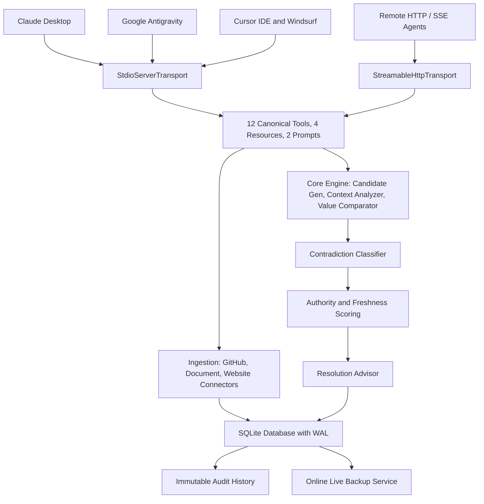
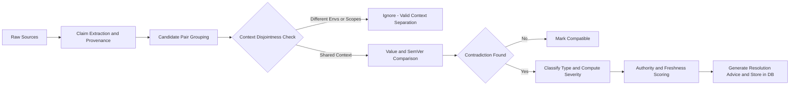
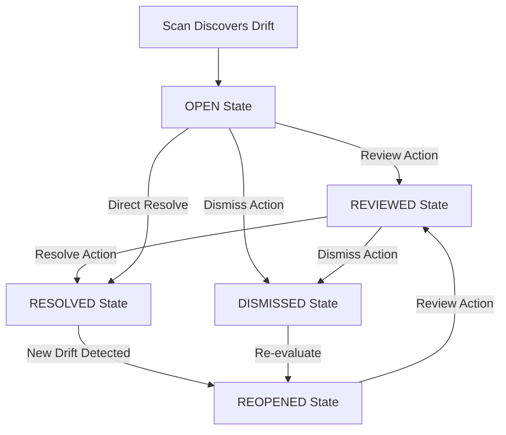

## The Silent Killer in Modern Software Engineering: Documentation Drift

Every developer has experienced this failure mode:

You clone a repository. The `README.md` clearly states:
> *"Prerequisites: Requires Node.js 18.x and PostgreSQL 14."*

You set up your local development environment, install dependencies, run migrations, and everything crashes on boot. After two hours of bisecting commit logs and inspecting Docker layers, you discover that three weeks ago, an engineer updated the `Dockerfile` to `FROM node:22-alpine`, while the Kubernetes Helm values file bumped PostgreSQL to `16.2`. 

Nobody updated the README. Nobody updated the architecture runbook. And the developer onboarding guide on the internal wiki still references Node 16.

```
       README.md: "Node.js 18"
            |
            +---- CONFLICT ----+
            |                  |
      Dockerfile: "Node 22"   Helm: "PostgreSQL 16" vs Wiki: "PostgreSQL 14"
```

In human engineering teams, documentation drift produces lost sprints, broken deployments, and onboarding friction. But in the era of **autonomous AI coding agents** (Claude Desktop, Cursor, Google Antigravity, GitHub Copilot Workspace, Windsurf), documentation drift is catastrophic. 

AI agents read your technical documents, trust them unconditionally, formulate execution plans based on stale assumptions, generate incorrect code, and trigger cascading CI failures.

To address this problem systematically, I built and open-sourced **[Contradiction MCP](https://github.com/Daksh-create349/Contradiction-MCP)**—an autonomous, cross-source inconsistency and contradiction intelligence engine built on the Model Context Protocol (MCP).

---

## Project Milestones and Community Adoption

Since releasing the project, the adoption and community feedback across the ecosystem have been strong:

- **100+ Weekly Downloads on NPM**: The `contradiction-mcp` package has crossed 100 weekly downloads on the public NPM registry.
- **100/100 Glama Quality Score**: Certified Grade A tool definitions on Glama's MCP Directory.
- **98/100 Smithery Score**: Verified registry entry on Smithery.
- **Live Cloud Endpoint**: Deployed and operating live at [https://contradiction-mcp.onrender.com](https://contradiction-mcp.onrender.com).
- **Open Source Repository**: Hosted publicly on GitHub at [https://github.com/Daksh-create349/Contradiction-MCP](https://github.com/Daksh-create349/Contradiction-MCP).

---

## What is Contradiction MCP?

**Contradiction MCP** is a production-grade Model Context Protocol server that continuously ingests facts ("claims") across fragmented engineering assets, runs pairwise consistency checks, eliminates false positives through contextual reasoning, and advises operators or agents on the canonical truth.

It connects to:
1. **Source Code Repositories**: Inspects `package.json`, `Dockerfile`, CI/CD workflows (`.github/workflows/*.yml`), and configuration manifests.
2. **Local Technical Documents**: Ingests Markdown (`.md`), YAML, JSON, CSV, plain text, RFC822 emails (`.eml`), Word documents (`.docx`), and binary PDFs (`.pdf`) with exact line- and page-numbered citation provenance.
3. **Public Web Endpoints and APIs**: Crawls web documentation and status pages with pre-flight DNS validation and Server-Side Request Forgery (SSRF) defenses.

### Core Architectural Pillars
- **Zero Mocks**: Real embedded SQLite with Write-Ahead Logging (WAL), foreign key enforcement, and 6 schema migrations.
- **Deterministic Mathematics**: SemVer range intersection algebra rather than fuzzy LLM evaluations or naive string equality.
- **Context-Aware Classification**: Differentiates between environments (`production` vs `staging`), scopes (`file` vs `deployment`), and source authority roles (`source_of_truth` vs `documentation`).
- **Human-in-the-Loop Lifecycle**: Full state transitions (`OPEN` -> `REVIEWED` -> `RESOLVED` / `DISMISSED` -> `REOPENED`) backed by append-only immutable audit logs.
- **Dual Transport Architecture**: Supports standard `stdio` for local IDEs and `Streamable HTTP/SSE` with Bearer authentication for distributed cloud deployments.

---

## System Architecture

Contradiction MCP implements the official **MCP TypeScript SDK v2** (`@modelcontextprotocol/server@2.0.0`, protocol specification version `2026-07-28`). The codebase is structured into clean, decoupled layers:



---

## Algorithmic Deep Dive: How Contradiction Detection Works

Detecting contradictions across heterogeneous technical files sounds straightforward, but naive implementations fail immediately. If `staging` uses `debug: true` and `production` uses `debug: false`, that is not a contradiction; it is a valid environment distinction. If one document references IP address `127.0.0.1` and another references port `8080`, they must never be compared just because both contain numbers.

Contradiction MCP resolves this through an end-to-end multi-stage pipeline:



### 1. Unified Claim Extraction and Line-Numbered Provenance

When a file is ingested, the connector parses structured assertions into normalized claims:

```typescript
export interface ExtractedClaim {
  subject: string;         // e.g., "api-server", "database"
  predicate: string;       // e.g., "node_version", "postgres_version", "port"
  value: string;           // e.g., "22.0.0", "5432"
  valueType?: string;      // e.g., "version", "number", "boolean", "string"
  confidence?: number;     // Extraction confidence (0.0 to 1.0)
  context?: {
    environment?: string;  // "production" | "staging" | "development"
    scope?: string;        // "file" | "deployment" | "cluster"
    sourceRole?: string;   // "deployment" | "configuration" | "documentation"
  };
  provenance: {
    filePath?: string;
    lineNumber?: number;
    pageNumber?: number;   // For PDF documents
    rawSnippet: string;    // Verbatim text line containing the claim
  };
}
```

By retaining the exact line number, file path, and snippet, any detected contradiction can be directly linked back to its source in code reviews or pull request comments.

### 2. SemVer Range Algebra and Value Type Isolation

String equality (`"18.0.0" === "18"`) is inadequate for engineering versions. Contradiction MCP implements deterministic version algebra via `semver`:

- Evaluates range constraints (`^18.2.0`, `>=20.0.0 and <23.0.0`) using set intersection and range satisfiability.
- If Range A and Range B share an overlapping valid version set, they are marked **compatible**.
- If Range A and Range B are mathematically disjoint, they are classified as **VERSION_MISMATCH** with high severity.
- Strict type discrimination ensures IPv4/IPv6 addresses, URLs, booleans, quantities, and ports are isolated. For example, `127.0.0.1` is detected as a network host and excluded from SemVer parsing.

### 3. Namespace-Aware Leaf Predicate Matching

Technical documents frequently organize configuration parameters under shared markdown headings or YAML blocks:

```yaml
# Configuration block A
server:
  host: "0.0.0.0"
  port: 8080

# Configuration block B
metrics:
  host: "127.0.0.1"
  port: 9090
```

Naive extractors often produce composite predicates like `server_configuration_port` vs `server_configuration_host`, causing false-positive collisions across unrelated attributes. Contradiction MCP enforces **leaf-predicate discrimination**: parameters sharing parent headings are disambiguated by their leaf property semantics so `host` is never compared against `port`.

### 4. Visual CI Badge Contradiction Detection

Markdown documentation commonly incorporates Shields.io or GitHub Actions status badges:

```markdown
[](...)
```

The document connector parses SVG and Markdown badge URLs, extracting claims such as `build_status: passing` or `code_coverage: 95%`. If a README badge declares passing status while a synchronized CI run report declares failing status, a contradiction is immediately raised.

### 5. Multi-Column Markdown Matrix Parsing

Markdown tables often contain complex matrices:

| Runtime | Staging | Production | Recommended |
| :--- | :--- | :--- | :--- |
| Python | 3.11 | 3.12 | 3.12+ |
| Node.js | 20.x | 22.x | 22.x |

The parser automatically detects table header rows and delimiter rows (`| :--- |`), extracting composite property claims tagged with their respective column contexts (`python_staging: 3.11`, `python_production: 3.12`).

---

## Intelligence Scoring: Authority and Freshness Decay

When two valid documents contradict each other, which one should be treated as canonical? Contradiction MCP avoids arbitrary heuristics by computing weighted scores.

### Authority Scoring Matrix

The AuthorityScorer computes a composite score between 0.0 and 1.0 based on four weighted factors:

```text
Authority Score = (0.40 * role_score) + 
                  (0.30 * trust_score) + 
                  (0.15 * location_score) + 
                  (0.15 * directness_score)
```

1. **Source Role Score (`role_score`, weight 0.40)**:
   - `authoritative` / `source_of_truth`: 1.00
   - `deployment` (Kubernetes, Helm, Terraform): 0.95
   - `configuration` (`package.json`, `.env.example`): 0.90
   - `specification` (OpenAPI, RFC): 0.75
   - `documentation` (README, guides): 0.55
   - `generated` (API docs, build output): 0.45
   - `example` / `informal`: 0.25
2. **Source Trust Score (`trust_score`, weight 0.30)**: Origin credibility assigned to the repository or domain.
3. **Location / Document Type Score (`location_score`, weight 0.15)**: Structured formats (`.json`, `.yaml`) score 0.95; code manifests score 0.90; prose guides score 0.50.
4. **Citation Directness Score (`directness_score`, weight 0.15)**: Claims with exact line numbers and surrounding code fences score higher than loose text mentions.

### Exponential Half-Life Freshness Decay

Documentation rots over time. The FreshnessScorer applies an exponential half-life decay model:

```text
Freshness Score = exp((-0.693 * delta_days) / half_life_days)
```

Where:
- `delta_days` is the age in days since the claim or source was observed.
- `half_life_days = 180` (calibrated 180-day half-life for technical infrastructure assertions).
- Claims flagged with explicit historical or deprecated markers receive a hard baseline ceiling of 0.10.
- Claims past their explicit `validUntil` expiration window receive a hard baseline ceiling of 0.15.

The `ResolutionAdvisor` combines authority and freshness to produce unambiguous recommendations:

```json
{
  "recommendedAction": "Accept Claim A ('22.0.0') over Claim B ('18.0.0').",
  "confidence": 0.96,
  "reason": "Claim A originated from deployment manifest (role weight: 0.95, age: 3 days) whereas Claim B originated from documentation guide (role weight: 0.55, age: 180 days).",
  "canonicalClaimId": "claim-uuid-node-22"
}
```

---

## The 12 Canonical MCP Tools (Glama Grade A)

Contradiction MCP exposes 12 canonical tools designed around strict `verb_noun` nomenclature, comprehensive Zod validation schemas, and isolated operational domains:

| Tool Name | Domain | Description | Key Arguments |
| :--- | :--- | :--- | :--- |
| `check_health` | Diagnostics | Verifies server runtime health, database connectivity, and active connectors | none |
| `list_sources` | Discovery | Lists registered knowledge sources with pagination and type filtering | `type`, `limit`, `offset` |
| `test_connection`| Connectivity| Tests network reachability and credentials without persisting data | `type`, `target`, `credentials` |
| `sync_source` | Ingestion | Unified ingestion for Markdown, PDF, Word (.docx), JSON, YAML, URLs, or Git repos | `sourceId` OR (`filePath` / `url` / `owner`+`repo`), `subject` |
| `scan_contradictions` | Intelligence| Scans the knowledge base, a source, or a claim for logical contradictions | `sourceId`, `claimId`, `limit`, `minConfidence` |
| `analyze_claim_pair` | Intelligence| Performs deep pairwise relationship analysis between two specific claims | `claimIdA`, `claimIdB` |
| `list_claims` | Knowledge Base | Queries extracted claims with multi-field filtering and pagination | `sourceId`, `subject`, `predicate`, `environment` |
| `get_claim` | Knowledge Base | Retrieves claim details, context, and provenance citations | `claimId` |
| `list_contradictions`| Lifecycle | Queries detected contradictions by status, severity, and confidence | `status`, `severity`, `minConfidence`, `limit` |
| `get_contradiction` | Lifecycle | Returns full contradiction state, conflicting claims, and explanation | `contradictionId` |
| `advise_resolution` | Advisory | Evaluates authority, freshness, and evidence to recommend canonical truth | `contradictionId` |
| `resolve_contradiction`| Resolution | Transitions lifecycle (`REVIEW`, `RESOLVE`, `DISMISS`, `REOPEN`) with audit logging | `contradictionId`, `action`, `actor`, `reason`, `canonicalClaimId` |

### Active MCP Resources (4)
- `health://metrics` — Real-time telemetry: uptime, tool invocation counts, contradiction tallies.
- `contradiction://{id}` — Dynamic resource for reading live contradiction records.
- `claim://{id}` — Dynamic resource for claim provenance and context.
- `source://{id}` — Dynamic resource for source metadata and trust weighting.

### Active MCP Prompts (2)
- `investigate_contradiction` — Guided interactive investigation workflow for agents and human operators.
- `review_source_consistency` — Step-by-step audit assistant for cross-checking newly updated repos or docs.

---

## Contradiction Lifecycle and Audit Trail

Resolving an infrastructure contradiction in an enterprise environment requires an immutable paper trail:



Every transition executes inside an atomic SQLite transaction that updates the contradiction record and appends an immutable entry to `contradiction_history`:

```sql
CREATE TABLE IF NOT EXISTS contradiction_history (
    id TEXT PRIMARY KEY,
    contradiction_id TEXT NOT NULL,
    action TEXT NOT NULL,               -- 'CREATED', 'REVIEWED', 'RESOLVED', 'DISMISSED', 'REOPENED'
    actor TEXT NOT NULL,                -- User email, agent ID, or system process
    reason TEXT,                        -- Mandatory justification for resolution or dismissal
    canonical_claim_id TEXT,            -- ID of the claim declared authoritative
    created_at TIMESTAMP DEFAULT CURRENT_TIMESTAMP,
    FOREIGN KEY (contradiction_id) REFERENCES contradictions(id) ON DELETE CASCADE,
    FOREIGN KEY (canonical_claim_id) REFERENCES claims(id) ON DELETE SET NULL
);
```

---

## Storage and Security Architecture

### 1. SQLite WAL Engine and Schema Migrations
All data persistence is handled by `better-sqlite3` using:
- `PRAGMA foreign_keys = ON;`
- `PRAGMA journal_mode = WAL;` (Write-Ahead Logging for high-concurrency read/write operations)
- Unique bidirectional pair indexing (`min_id || '::' || max_id`) preventing duplicate candidate storage.
- 6 automated schema migrations executed sequentially on startup.

### 2. Multi-Layer SSRF Defense for Web Scraping
Web-accessible connectors can be exploited to probe internal cloud environments. The `WebsiteConnector` enforces pre-flight validation via `ssrfGuard.ts`:
- Resolves DNS targets before issuing HTTP requests.
- Blocks IPv4 loopback (`127.0.0.0/8`), private subnets (`10.0.0.0/8`, `172.16.0.0/12`, `192.168.0.0/16`), and carrier-grade NAT (`100.64.0.0/10`).
- Blocks AWS/GCP instance metadata endpoints (`169.254.169.254`).
- Blocks IPv6 loopback (`::1`), link-local (`fe80::/10`), unique local (`fc00::/7`), and IPv4-mapped IPv6 (`::ffff:`).
- Disables automatic HTTP redirects, enforcing `redirect: 'manual'` with a maximum limit of 5 hops, validating every redirect destination against the SSRF filter.

### 3. Directory Traversal and Sandbox Containment
The `DocumentConnector` guarantees that agents cannot read unauthorized host files:
- Resolves file paths using `fs.realpathSync()`, neutralizing symlink-based jailbreak attempts.
- Enforces an `allowedRoots` boundary (defaulting to the active workspace). Any path resolving outside this directory tree throws an immediate `AuthorizationError`.

---

## Practical End-to-End Walkthrough

The following walkthrough demonstrates how an AI agent uses Contradiction MCP to detect and resolve version drift between production configurations and documentation.

### Step 1: Ingest Production Deployment Manifest

Invoking `sync_source`:
```json
{
  "filePath": "./deployment/production-spec.json",
  "subject": "api-gateway",
  "environment": "production",
  "sourceRole": "deployment"
}
```

Response:
```json
{
  "success": true,
  "sourceId": "d3b07384-d113-4e4e-8c3b-55c3c0a1b2c3",
  "claimsCreated": 4,
  "claimsUpdated": 0
}
```

### Step 2: Ingest Architecture Documentation

Invoking `sync_source`:
```json
{
  "filePath": "./docs/architecture.md",
  "subject": "api-gateway",
  "environment": "production",
  "sourceRole": "documentation"
}
```

### Step 3: Run Contradiction Scanner

Invoking `scan_contradictions`:
```json
{
  "minConfidence": 0.8
}
```

Response:
```json
{
  "status": "completed",
  "claimsScanned": 8,
  "candidatePairs": 4,
  "contradictionsFound": 1,
  "contradictions": [
    {
      "contradictionId": "e2147f29-a546-4a7c-97f1-cc00b81a7a81",
      "contradictionType": "VERSION_MISMATCH",
      "severity": "HIGH",
      "confidence": 1.0,
      "priorityScore": 0.95,
      "explanation": "Both claims declare node_version for 'api-gateway' in production. However, docs/architecture.md reports '18.0.0' (line 42) while deployment/production-spec.json reports '22.0.0' (line 15). The version ranges are mutually exclusive."
    }
  ]
}
```

### Step 4: Request Resolution Advice

Invoking `advise_resolution`:
```json
{
  "contradictionId": "e2147f29-a546-4a7c-97f1-cc00b81a7a81"
}
```

Response:
```json
{
  "recommendedAction": "Accept Claim from production-spec.json ('22.0.0') over Claim from architecture.md ('18.0.0').",
  "confidence": 0.96,
  "reason": "production-spec.json carries higher source authority (role: deployment, score: 0.95) and recent modification, whereas architecture.md has lower authority (role: documentation, score: 0.55).",
  "canonicalClaimId": "claim-uuid-node-22"
}
```

### Step 5: Execute Resolution with Audit Log

Invoking `resolve_contradiction`:
```json
{
  "contradictionId": "e2147f29-a546-4a7c-97f1-cc00b81a7a81",
  "action": "RESOLVE",
  "actor": "sre-engineer@company.com",
  "reason": "Verified Node 22 is running in production. Created ticket DOC-304 to update architecture.md.",
  "canonicalClaimId": "claim-uuid-node-22"
}
```

---

## Universal Quickstart (All IDEs)

### One-Command CLI Installation
Configure Contradiction MCP across your local tools with a single command:

```bash
# Configure Claude Desktop, Cursor, Antigravity, and Windsurf all at once:
npx -y contradiction-mcp install all
```

Or target a specific environment:
```bash
# Google Antigravity
npx -y contradiction-mcp install antigravity

# Cursor IDE
npx -y contradiction-mcp install cursor

# Claude Desktop App
npx -y contradiction-mcp install claude

# Claude Code CLI
npx -y contradiction-mcp install claude-code

# Windsurf IDE
npx -y contradiction-mcp install windsurf

# Smithery CLI
npx -y smithery mcp add dakshshrivastav56/contradiction-mcp
```

### Manual Configuration
If you prefer explicit configuration, add this block to your client settings (`claude_desktop_config.json`, `.cursor/mcp.json`, or `.gemini/config/mcp_config.json`):

```json
{
  "mcpServers": {
    "contradiction": {
      "command": "npx",
      "args": ["-y", "contradiction-mcp"],
      "env": {
        "NODE_ENV": "production",
        "DATABASE_PATH": "./data/contradiction.db",
        "MCP_TRANSPORT": "stdio",
        "LOG_LEVEL": "error"
      }
    }
  }
}
```

### Running as a Remote Streamable HTTP Service
For CI/CD pipelines or shared organizational infrastructure, launch Contradiction MCP as a daemon:

```bash
MCP_TRANSPORT=http HTTP_PORT=3000 API_KEY=secret-token npx -y contradiction-mcp
```

Clients connect over HTTP/SSE:
```json
{
  "mcpServers": {
    "contradiction": {
      "url": "http://localhost:3000/mcp",
      "headers": {
        "Authorization": "Bearer secret-token"
      }
    }
  }
}
```

---

## Roadmap and Next Steps

Documentation drift is an ongoing challenge in fast-moving engineering environments. By giving AI agents the tools to verify assertions across repositories, specifications, and documentation, we can prevent regressions before code merges.

Upcoming milestones on the roadmap:
- Native Confluence and Notion workspace connectors.
- Automated GitHub Action PR review bot that flags contradictions directly on pull requests.
- Bidirectional schema synchronization with OpenAPI 3.1 and AsyncAPI definitions.
- Multi-language technical terminology extraction.

### Links and Resources
- GitHub Repository: [https://github.com/Daksh-create349/Contradiction-MCP](https://github.com/Daksh-create349/Contradiction-MCP)
- Live Website: [https://contradiction-mcp.onrender.com](https://contradiction-mcp.onrender.com)

Contributions, issue reports, and feedback are welcome on GitHub.

